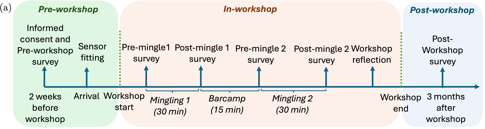

# COSILab

This repository contains data-processing utilities and model baselines for the COSILab pipeline. Each major component has its own README with operational details.

Note: For historical reasons, COSI-Lab was called INGroup before.

## Components

### midge_postprocess

Documentation for the midge (Mingle/OpenBadge) sensor-device tools. The code itself is not in this repository: it lives in `BadgeFramework` in the [midge-code repository](https://github.com/TUDelft-SPC-Lab/midge-code/tree/v0.2.0%2Bcosilab-datacapture/BadgeFramework), which has its own installation instructions.

- Decodes raw badge audio, timestamps, IMU, rotation, and scan binaries.
- Provides the hub workflow for starting/stopping badges and periodically synchronising device clocks.
- Details: [midge_postprocess/README.md](midge_postprocess/README.md)

### video_postprocess

Camera and video preprocessing utilities.

- Repairs GoPro chunks truncated by a dead battery.
- Concatenates raw per-camera GoPro video chunks into one timecoded video per camera.
- Cuts relative or absolute-timecode video intervals, splits intervals into frame images, and writes per-frame real-time timestamp CSVs, all frame-accurate across chunk files.
- Generates camera calibration projects and converts solved calibration to IDIAP/EasyMocap formats.
- Details: [video_postprocess/README.md](video_postprocess/README.md)

### audio_postprocess

Code-only audio and transcript postprocessing utilities for dataset release workflows.

- Runs WhisperX-based transcription/alignment wrappers for audio clips and main-speaker audio.
- Supports Presidio/spaCy PII detection, audio redaction, and pseudonymized transcript generation.
- Includes mingling main-speaker utilities that consume externally generated diarization RTTM files, such as NeMo outputs.
- Does not include raw audio, transcripts, model weights, generated outputs, logs, caches, or cluster scripts.
- Details: [audio_postprocess/README.md](audio_postprocess/README.md)

### baselines

Model baselines and downstream feature-generation code.

- `conversation_group/SAM3`: SAM3/SAM-Body4D-based mask generation for INGroup video segments.
- `conversation_group/ViTPose`: ViTPose finetuning, SAM3-bbox-based keypoint inference, and conversion of keypoint JSON to dataframe PKL.
- `conversation_group/graphff`: conversation-group (F-formation) detection benchmark on the Mingling cameras, with LSTM/GraphFF and DANTE pipelines and a cross-camera evaluation matrix.
- `intention`: multimodal intention-recognition inference (backend- and mode-selectable, with persona and prompt-variation runs), pre-annotation survey analysis, and model-vs-human annotation similarity comparison.
- SAM3 details: [baselines/conversation_group/SAM3/README.md](baselines/conversation_group/SAM3/README.md)
- ViTPose details: [baselines/conversation_group/ViTPose/README.md](baselines/conversation_group/ViTPose/README.md)
- GraphFF/DANTE details: [baselines/conversation_group/graphff/README.md](baselines/conversation_group/graphff/README.md)
- Intention details: [baselines/intention/README.md](baselines/intention/README.md)

## Environments

There is no repository-wide environment; each component declares its own dependencies:

| Component | Dependency spec |
| --- | --- |
| `video_postprocess` | `pyproject.toml` + `uv.lock` (`uv sync`); Apptainer image `apptainer/video_postprocess.def` for the cluster |
| `audio_postprocess` | `requirements.txt` |
| `baselines/conversation_group/SAM3` | `pyproject.toml` and vendored `models/sam3/pyproject.toml`, following upstream SAM-Body4D |
| `baselines/conversation_group/ViTPose` | upstream ViTPose `requirements/` and `setup.py` |
| `baselines/conversation_group/graphff` | Apptainer image `apptainer/deep_fformation.def`, or `environment-lstm-local.yml` for the LSTM pipeline |
| `baselines/intention` | `pyproject.toml` + `uv.lock` (`uv sync`); per-backend Apptainer images on the cluster. The notebooks and R scripts have their own dependencies |

## Typical Flow

1. Decode and synchronise badge sensor data with `BadgeFramework` (see `midge_postprocess`).
2. Merge/cut videos and prepare camera calibration with `video_postprocess`.
3. Run audio/transcript redaction or mingling main-speaker pseudonymization with `audio_postprocess` when preparing release-safe audio-derived text.
4. Generate masks with SAM3, run ViTPose, benchmark conversation-group detection with GraphFF/DANTE, run intention inference, and compare model outputs with human annotations under `baselines`.

Refer to the component READMEs for exact commands, expected folder layouts, and cluster-specific paths.

## References

- Tan, Stephanie, David M. J. Tax, and Hayley Hung. "Conversation group detection with spatio-temporal context." Proceedings of the 2022 International Conference on Multimodal Interaction. 2022.
- Carion, Nicolas, et al. "SAM 3: Segment anything with concepts." arXiv preprint arXiv:2511.16719. 2025.
- Xu, Yufei, et al. "ViTPose: Simple vision transformer baselines for human pose estimation." Advances in Neural Information Processing Systems 35. 2022: 38571-38584.
- Swofford, Mason, et al. "Improving social awareness through DANTE: Deep affinity network for clustering conversational interactants." Proceedings of the ACM on Human-Computer Interaction 4.CSCW1. 2020: 1-23.
